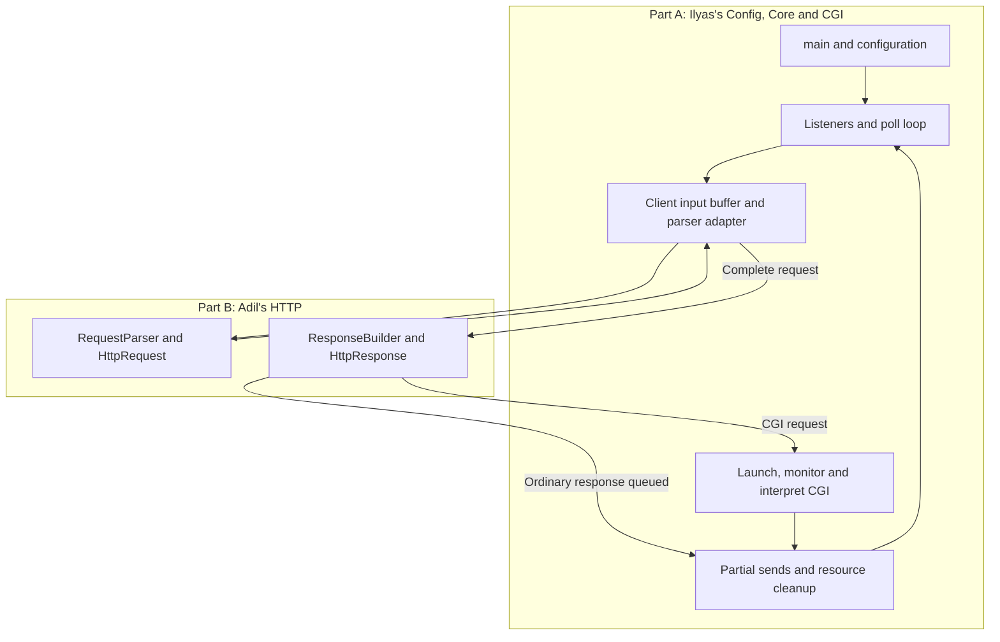

# How Webserv works — from main() to Core and HTTP

This guide follows the current implementation, starting at `main()`. Read it
with the code open and trace one request before studying every helper function.

## 1. The program has two main parts

| Part | Owner | Job |
| --- | --- | --- |
| **A: Configuration, Core and CGI** | Ilyas | Read settings, open listeners, manage clients, schedule I/O, enforce limits, run CGI and clean up resources. |
| **B: HTTP request and response handling** | Adil | Represent and decode HTTP requests, choose ordinary route actions, handle files/uploads/listings, build responses and supply MIME types. Cookies/sessions are his bonus work. |

These are two areas of responsibility inside **one executable**. They are not
two independent servers. The parent process uses one event loop. A CGI request
can create a separate child process to run an interpreter.

The basic cooperation is:

> Core receives bytes → the adapter and HTTP parser identify the request →
> HTTP handling chooses the response → Core sends the queued bytes.

CGI adds another path:

> HTTP handling calls Ilyas's CGI bridge → Ilyas's CGI code runs the script and
> constructs its response → Core sends that response.



The arrows show handoffs of control/data. The request does not move through all
of these boxes in one uninterrupted operation: incomplete work waits for later
readiness events.

## 2. Start reading at main()

Open [main.cpp](/home/ily4s/Desktop/WEBSERV/srcs/main.cpp:8).
The essential sequence in the real function is:

```cpp
const char* path = argc == 2 ? argv[1] : "configs/default.conf";
Config config;
config.load(path);
Server server(config);
server.initializeListeners();

// The actual function prints the configured endpoints and a readiness message here.
server.run();
return EXIT_SUCCESS;
```

### Step 1: Choose the configuration path

```sh
./webserv
./webserv configs/test.conf
```

The first command uses `configs/default.conf`. The second uses the supplied
path. More than one configuration argument produces a usage error.
Relative paths are interpreted from the working directory, so launch these
examples from `/home/ily4s/Desktop/WEBSERV`.

### Step 2: Read and validate configuration

`Config config;` creates the settings container. `config.load(path)` then:

1. Reads configuration text and turns it into tokens: words, braces and semicolons.
2. Parses the tokens according to the supported grammar.
3. Validates settings, including ports, duplicates, methods and body sizes.
4. Builds ServerBlock and LocationBlock objects.
5. Applies inherited location defaults after each server block is complete.
6. Installs the new settings only after the whole load succeeds.

For example:

```text
Config
└── ServerBlock: 127.0.0.1:8080
    ├── LocationBlock /          → root ./www
    ├── LocationBlock /uploads   → root ./www/uploads
    ├── LocationBlock /cgi-bin   → root ./cgi-bin, .py interpreter
    └── LocationBlock /redirect  → redirect to /
```

**ServerBlock is stored configuration. Server is the live runtime.**
LocationBlock stores rules for one URL prefix; it does not accept a connection
or serve a file by itself.

If loading fails, an exception reaches the handler in `main()`, which reports
the error and returns failure. The event loop never starts with invalid settings.

### Step 3: Construct the runtime

`Server server(config);` stores a reference to the loaded configuration and
validates the Core resource limits. Constructing Server does not yet accept
clients or enter the event loop.

There is **one Server runtime for all configured ServerBlocks**. Two server
blocks on different ports mean two listening sockets managed by that runtime.

### Step 4: Open listening sockets

`server.initializeListeners()` visits the configured endpoints. For each one,
it resolves the numeric address, creates a socket, enables address reuse, makes
it nonblocking, binds it to the address/port and calls `listen()`.

It stores the listener descriptor together with a pointer to its ServerBlock.
A file descriptor, or **fd**, is the integer handle used to refer to an open
socket, file or pipe.

A listener waits for new connections. It is different from the connected socket
returned by `accept()` for one client.

If any listener setup fails, the initialization releases the listeners already
opened during that attempt and propagates the failure. Only after successful
initialization does `main()` print “Server ready”.

### Step 5: Enter the event loop

`server.run()` is where the running server spends most of its time. `main()`
does not call the HTTP parser directly for each request. The event loop calls
the appropriate functions as descriptors become ready.

## 3. Part A — Core manages progress and ownership

### What happens inside Server::run?

Each iteration builds the current list of descriptors, calls `poll()` and
dispatches the returned events. It also checks CGI completion and deadlines.

| Ready resource | Core action |
| --- | --- |
| Listener readable | `acceptReady()` accepts a connection and creates a Client. |
| Client readable while reading a request | `readClient()` receives bytes and calls `processInput()`. |
| Client writable while writing a response | `writeClient()` sends a bounded part of the pending output. |
| CGI input pipe writable | `transferCgi()` sends more decoded request-body bytes to the child. |
| CGI output pipe readable | `transferCgi()` collects more script output. |
| Failure, disconnect or expired deadline | Close/cancel the affected resources and retain any required child cleanup. |

`poll()` may wait for readiness; the current loop uses a 200 ms timeout. This
is different from blocking inside a client read until an entire request arrives.
The parent handles socket and pipe transfers after readiness and returns to
the loop so other connections can progress.

### What is a Client?

`acceptReady()` creates a Client for the connected socket and associates it with
the ServerBlock of the listener that accepted it. Client stores:

- Input bytes and a RequestParserAdapter, which contains the shared HttpRequest.
- An HttpResponse, queued output bytes and the current send offset.
- The connection's current state and close/reuse policy.
- References to the selected settings and owning runtime, plus peer details.
- Timing information and an optional file descriptor for streamed output.

A Client represents a **TCP connection**. It can handle several successive HTTP
requests if the connection stays open. Resetting a request is different from
destroying the connection.

The main transitions in the current implementation are shown below. The labels
omit the enum's `STATE_` prefix for readability:

```text
READING_REQUEST
    → BUILDING_RESPONSE
        → WRITING_RESPONSE
        or
        → CGI_RUNNING → BUILDING_RESPONSE → WRITING_RESPONSE

After output finishes:
    → READING_REQUEST for another request
    or
    → close and remove the Client
```

The enum also declares REQUEST_COMPLETE and DONE. The main path above does not
need to visit every declared enum value.

### Who owns cleanup?

| Resource | Owner after successful creation/handoff |
| --- | --- |
| Settings objects | Config; it must remain alive while Server/Client borrow them. |
| Listening sockets | Server. |
| Connected socket and allocated Client | Server; `closeClient()` closes the socket and deletes the Client. |
| Queued regular-file descriptor | Client after a successful `queueFile()` handoff. |
| CGI child and parent pipe ends | Server after successful CGI attachment; launcher/caller cleanup applies before that handoff. |

This matters because an fd is only an integer. Its type does not automatically
say which part of the program must close it.

## 4. Follow a normal request through both parts

Suppose the browser sends this request to the default site's port 8080:

```http
GET / HTTP/1.1
Host: localhost
Connection: close

```

The real wire format uses CRLF line endings and an empty line after the headers.

### A. Core receives bytes

When the connected socket becomes readable, `Server::readClient()` calls
`recv()`, appends the received bytes to Client's input buffer and calls
`processInput()`.

It does not assume one recv equals one request. For example, the first receive
could end at `Ho` and the next start with `st: localhost`.

### B. Ilyas's adapter wraps Adil's parser

`processInput()` calls `client.getParser().feed(...)`. In the current code,
`getParser()` returns **RequestParserAdapter**, not the raw RequestParser.

The adapter guards framing, numeric bounds, headers and URI normalization. It
delegates decoding to Adil's RequestParser and exposes that parser's HttpRequest.
Incomplete header bytes remain available until the complete header block arrives.

The adapter reports four results to Core:

| Result | What Core does |
| --- | --- |
| PARSE_INCOMPLETE | Wait for more input. |
| PARSE_HEADERS_COMPLETE | Select the location, set its effective body limit and check declared-body admission before consuming the body. |
| PARSE_COMPLETE | Enter BUILDING_RESPONSE and dispatch response handling. |
| PARSE_ERROR | Ask the HTTP builder for an error response and close after sending. |

Even a GET without a body goes through the header handoff. With the current
default config, `/` allows zero request-body bytes, `/uploads` allows 10 MiB
and `/cgi-bin` allows 1 MiB. These limits do not describe response sizes.

After successful parsing, the shared HttpRequest contains the method, decoded
path, separate raw query string, version, headers and decoded binary body.

### C. Core supplies the correct site context

`Server::buildResponseForClient()` creates a borrowed `Config::forServer(...)`
view for this Client's actual ServerBlock, and establishes its connection policy.
It also intercepts configured CGI directory indexes before ordinary file handling.

For this normal GET, it calls:

```cpp
ResponseBuilder::buildResponse(client, requestConfig);
```

The supplied view lets Adil's response code use Config lookups while remaining
tied to the correct listening site. A misleading Host value does not switch the
connection to another local website. Name-based virtual hosts are not implemented.

### D. Part B chooses and constructs the response

ResponseBuilder finds the configured server/location and selects its route
behavior. It handles configured redirects, method policy, ordinary GET/POST/DELETE
actions and the CGI hook. Those actions read LocationBlock settings.

For `GET /`, the selected root is `./www`, the target is a directory and the
configured index is `index.html`. The ordinary handler reads that file, chooses
its MIME type through MimeTypes and fills HttpResponse with status, headers and body.

HttpResponse is the structured response. `serialize()` turns it into the bytes
to send: status line, headers, blank line and stored body. The ordinary HTTP
path stores those bytes in `Client::getWriteBuffer()` and enters WRITING_RESPONSE.

**Constructing a response does not send it.** Part B prepares the output; Core
performs the socket sends. Core also supplies the selected site's custom-error
context when imported file handlers omit it.

The current static GET handler buffers the whole file. Ilyas's `queueFile()`
streaming interface exists and is tested, but that HTTP handler has not adopted
it yet. Keep this distinction when explaining the actual program.

### E. Core sends the queued response

On a writable event, `writeClient()` sends at most 16 KiB and advances the offset
by the bytes actually sent. It keeps the remaining bytes for later events.

For example, sending 300 bytes of a 1000-byte queue leaves 700 bytes pending.
A successful send does not mean the whole response has been transmitted.

Once output is drained, Core either closes the connection or resets request
state for reuse. Our example requests `Connection: close`, so it closes.
For reuse, unread bytes belonging to the next pipelined request are preserved
and processed after the previous response finishes, keeping response order.

## 5. Follow a CGI request through both parts

Now consider:

```sh
curl --data-binary 'hello' \
  'http://127.0.0.1:8080/cgi-bin/test.py/extra?name=example'
```

Receiving, parsing, route-limit selection and site-context selection happen as
above. The complete decoded request body is `hello`.

### A. Adil's HTTP code calls Ilyas's CGI bridge

ResponseBuilder recognizes the configured CGI extension and calls `_handleCGI`.
That method's definition lives in Ilyas's `CgiBridge.cpp`, where it calls
`CgiHandler::handle()`.

This is the exact handoff from Adil's HTTP dispatch to Ilyas's full CGI implementation.

### B. Ilyas's CGI code selects and launches the script

The resolver separates the request into:

| CGI input | Value in this example |
| --- | --- |
| Script name | `/cgi-bin/test.py` |
| Script file | `./cgi-bin/test.py` |
| Interpreter | `/usr/bin/python3` |
| PATH_INFO | `/extra` |
| QUERY_STRING | `name=example` |
| REQUEST_METHOD | `POST` |
| CONTENT_LENGTH | `5`, the decoded body size |

The production call path includes:

```text
ResponseBuilder::_handleCGI
    → CgiHandler::handle
    → CgiHandler::launch
    → Server::launchCgi
    → CgiHandler::spawn
    → Server::attachCgi
```

The launcher verifies the script/interpreter, prepares arguments and an explicit
environment, creates two pipes and calls `fork()`. In the child, `dup2()` connects
the pipes to stdin/stdout, unused descriptors are closed, the working directory
is changed to the script's directory, and `execve()` starts the interpreter.

`fork()` creates the child. `execve()` replaces the child's program; it does not
create an additional process. Query text is passed through the environment,
not executed as a shell command.

### C. Core moves input and output while serving other clients

After successful attachment, the Client is CGI_RUNNING and Server owns the
child lifecycle and parent pipe ends. The same event loop watches:

```text
Client request.body → parent input-pipe write end → child stdin
child stdout → parent output-pipe read end → accumulated CGI output
```

Core closes CGI stdin after sending all decoded body bytes. That tells the
script it has reached EOF. For a chunked HTTP request, the body has already been
unchunked before it reaches stdin.

Input and output progress together. Writing the entire input before reading any
output could fill both pipes and deadlock. The parent uses bounded transfers
through poll and continues handling other clients.

### D. Ilyas's CGI response parser queues HTTP output

Server checks child status with `waitpid(..., WNOHANG)` and collects output until
EOF. It waits for both an observed child exit and drained output before successful
completion; child exit and pipe EOF are different events.

`finishCgiJobs()` invokes Ilyas's CgiResponse callback. It validates CGI headers and
body, checks exit status, handles Status/Location/cookies, and constructs the
HTTP wire response. CGI fields are serialized separately so repeated Set-Cookie
headers survive the shared response map's current limitation.

Core then sends that queue through the same `writeClient()` path used for ordinary
responses. A CGI local redirect instead requests deferred redispatch after the
old job is cleaned up; its chain is limited to five.

A timed-out CGI normally produces 504. Bad execution/output normally produces
502. Admission pressure can produce 503. The default CGI deadline is 15 seconds
and accumulated output cap is 8 MiB. Disconnects/failures close pipes, terminate
an unreaped child when necessary and retain cleanup responsibility until reaping.

## 6. Where cookies and sessions fit today

Adil has cookie helpers and Session/SessionManager classes. The ordinary HTTP
request path does not yet create/look up sessions or automatically attach session
cookies. The mandatory Makefile does not include the unused session sources.

Therefore, there is no active session-manager step to follow from main in the
current executable. Session configuration directives are also not implemented.
CGI can still receive Cookie headers and produce Set-Cookie fields independently
of that C++ session system.

When session integration is added, it must use storage that survives requests
and TCP connections. Its place in the live request flow and any required Core
accessor need an agreed interface. The pending work is recorded in
[the session handoff](/home/ily4s/Desktop/WEBSERV/Docs/sessions_and_http.md).

## 7. How execution finishes

The signal handler for Ctrl-C/termination sets a stop flag. The event loop notices
it and calls `closeAll()`: clients and listeners close, CGI jobs are cancelled as
needed, and retired children are reaped. Then `run()` returns to main.

On normal completion, main returns success. Errors that escape the runtime reach
main's exception handlers and result in failure. C++ destroys local objects when
leaving their scope, including during exception unwinding.

Config was constructed before Server, so **Server is destroyed before Config**.
That keeps borrowed settings valid while the runtime releases its resources.
The Server destructor also calls `closeAll()`; cleanup handles already-cleared
resources safely.

## 8. A practical reading order

Follow the functions rather than trying to memorize every file at once.

| Order | Open | Question to answer |
| --- | --- | --- |
| 1 | [main.cpp](/home/ily4s/Desktop/WEBSERV/srcs/main.cpp) | What starts first, and when does the loop begin? |
| 2 | [LocationBlock.cpp](/home/ily4s/Desktop/WEBSERV/srcs/config/LocationBlock.cpp), [ServerBlock.cpp](/home/ily4s/Desktop/WEBSERV/srcs/config/ServerBlock.cpp) | What settings does one route/site store? |
| 3 | [Config.cpp](/home/ily4s/Desktop/WEBSERV/srcs/config/Config.cpp) | How does text become validated settings? |
| 4 | [Server.cpp](/home/ily4s/Desktop/WEBSERV/srcs/core/Server.cpp) | Follow initializeListeners, run, acceptReady, readClient and processInput. |
| 5 | [Client.cpp](/home/ily4s/Desktop/WEBSERV/srcs/core/Client.cpp) | What survives across events, and what resets between requests? |
| 6 | [RequestParserAdapter.cpp](/home/ily4s/Desktop/WEBSERV/srcs/core/RequestParserAdapter.cpp), [RequestParser.cpp](/home/ily4s/Desktop/WEBSERV/srcs/http/RequestParser.cpp), [HttpRequest.hpp](/home/ily4s/Desktop/WEBSERV/includes/HttpRequest.hpp) | How are bytes guarded, decoded and exposed as a request? |
| 7 | [ResponseBuilder.cpp](/home/ily4s/Desktop/WEBSERV/srcs/http/ResponseBuilder.cpp), [HttpResponse.cpp](/home/ily4s/Desktop/WEBSERV/srcs/http/HttpResponse.cpp) | How is an ordinary response selected and queued? |
| 8 | Server.cpp: buildResponseForClient and writeClient | Where does control return to Core, and how are partial sends handled? |
| 9 | [CgiHandler.cpp](/home/ily4s/Desktop/WEBSERV/srcs/cgi/CgiHandler.cpp), [CgiBridge.cpp](/home/ily4s/Desktop/WEBSERV/srcs/cgi/CgiBridge.cpp), [CgiLauncher.cpp](/home/ily4s/Desktop/WEBSERV/srcs/cgi/CgiLauncher.cpp), [CgiResponse.cpp](/home/ily4s/Desktop/WEBSERV/srcs/cgi/CgiResponse.cpp) | How does a CGI request leave and return to the normal response path? |
| 10 | Server.cpp: transferCgi, finishCgiJobs, cancelCgi, closeClient and closeAll | Who closes each resource on success, failure and shutdown? |

For each function, identify its input, changed state, output, caller and cleanup
responsibility. Then trace `GET /` and the CGI POST example without looking at
this guide.

### A short explanation to practise

> Main loads and validates the configuration, constructs one runtime Server,
> opens its listeners and enters the poll loop. Core accepts connections and
> preserves each Client's partial work. My adapter wraps Adil's HTTP parser and
> lets Core apply the route's body limit before collecting the body. Adil's HTTP
> code builds ordinary responses or calls my CGI bridge. I own CGI launch,
> pipes, output parsing and lifecycle. Core sends queued output incrementally,
> then reuses or closes the connection and cleans up its resources.

This guide explains the code's current paths; it is not a claim that every HTTP
feature is finished. Production file streaming, session integration and other
known fixes remain in [remaining_problems.md](/home/ily4s/Desktop/WEBSERV/Docs/remaining_problems.md).
The guide was checked against source, without running a new test suite or
changing the implementation.
