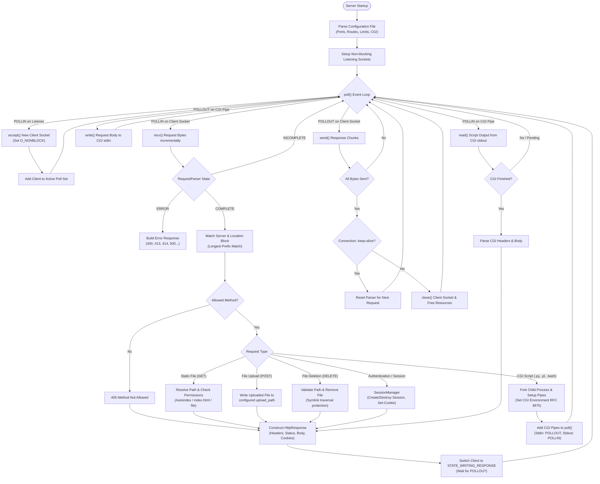

# Webserv

> A lightweight, fully non-blocking **HTTP/1.1 web server** implemented in **C++98**, built as part of the 42 curriculum by **irfei** and **ajamoun**.

---

##  Overview

**Webserv** is an event-driven HTTP server capable of handling multiple concurrent client connections, serving static content, managing file uploads, executing CGI scripts dynamically, and maintaining persistent user sessions.

The entire server runs on a **single-threaded, non-blocking I/O multiplexing architecture** using the `poll()` system call—preventing blocking operations across listening sockets, client socket I/O, and inter-process CGI communication pipes.

---

## Architecture & Request Processing Flow

The following Mermaid diagram illustrates the end-to-end lifecycle of a client connection and request inside Webserv:



---

##  Key Features

* **Non-Blocking I/O Multiplexing**: Single-threaded event loop driven by `poll()`. Sockets and pipes never block execution.
* **HTTP/1.1 Protocol Compliance**:
  * Implements `GET`, `POST`, and `DELETE` methods.
  * Robust header parsing, status code handling, and custom error pages.
  * Supports `Transfer-Encoding: chunked` for streaming uploads and requests.
  * Persistent connection management (`Connection: keep-alive` vs `close`).
* **Dynamic CGI Execution (RFC 3875)**:
  * Non-blocking CGI stdin/stdout streaming via UNIX pipes.
  * Supports interpreters configured per file extension (e.g. Python, Perl, Bash, PHP).
  * Enforces execution timeouts to prevent hung scripts.
* **Flexible Configuration Engine**:
  * Configurable ports, hostnames, and virtual hosts (`server_name`).
  * Custom routing per location with root paths, default index files, method restrictions, and redirects (301/302).
  * Automatic directory listing (`autoindex on/off`).
  * Configurable `client_max_body_size` per server and per route.
* **Security & Path Resolution**:
  * Protection against directory traversal attacks (`..`).
  * Strict validation preventing symlink breakouts during file removal.
* **Session & Cookie Support**:
  * Built-in `SessionManager` supporting cookies (`Set-Cookie`, `Cookie`).
  * Stateful authentication example (`/login` and `/logout`).

---
##  Project Structure

```
.
├── Makefile              # Build configuration (C++98 strict flags)
├── README.md             # Project documentation
├── configs/              # Server configuration files
│   ├── default.conf      # Main production-like config
│   └── test.conf         # Multi-port configuration for testing
├── includes/             # C++ header files
│   ├── Client.hpp        # Client socket connection state machine
│   ├── Server.hpp        # Listener management & poll() event loop
│   ├── Config.hpp        # Configuration parser & storage
│   ├── HttpRequest.hpp   # HTTP request representation
│   ├── HttpResponse.hpp  # HTTP response builder & serializer
│   ├── RequestParser.hpp # Stream-based chunked request parser
│   ├── ResponseBuilder.hpp # Route dispatching & file handling
│   ├── CgiHandler.hpp    # CGI fork, pipes & execution management
│   └── SessionManager.hpp# Session store and cookie tracking
├── srcs/                 # C++ implementation files
│   ├── main.cpp          # Entry point
│   ├── config/           # Config file tokenization & parsing
│   ├── core/             # Server event loop & Client state machine
│   ├── http/             # Request parsing & HTTP response building
│   ├── cgi/              # CGI execution & output parsing
│   ├── sessions/         # Session management & demo auth handlers
│   └── utils/            # MIME types & helpers
├── tests/                # Integration test suite (Python unittest)
└── www/                  # Static web root, upload folder, error pages
```

---

## Getting Started

### Prerequisites

* A C++ compiler with C++98 support (`clang++` or `g++`)
* `make`
* Python 3.8+ (for running the integration test suite)
* Interpreters for testing CGI: `python3`, `perl`, `bash`

### Compilation

Build the executable:

```bash
make
```

### Running the Server

Start Webserv with the default configuration:

```bash
./webserv
```

Or pass a custom configuration file:

```bash
./webserv configs/default.conf
```

Once running, navigate to [http://127.0.0.1:8080](http://127.0.0.1:8080) in your web browser. Press `Ctrl + C` to gracefully stop the server.

---

##  Testing

Webserv comes with an automated integration test suite covering routing, chunked transfers, body limits, CGI execution, and uploads:

```bash
make test
# Or directly:
python3 -m unittest tests/test_webserv.py
```

---

##  Configuration Syntax

Configurations are structured into `server` blocks and `location` directives:

```nginx
server {
    listen 127.0.0.1:8080;
    server_name localhost;
    client_max_body_size 10M;

    error_page 404 /error_pages/404.html;

    location / {
        root ./www;
        index index.html;
        allowed_methods GET;
        autoindex off;
    }

    location /uploads {
        root ./www/uploads;
        upload_path ./www/uploads;
        allowed_methods GET POST DELETE;
        autoindex on;
    }

    location /cgi-bin {
        root ./cgi-bin;
        cgi_extension .py /usr/bin/python3;
        cgi_extension .pl /usr/bin/perl;
        cgi_extension .bash /usr/bin/bash;
        allowed_methods GET POST;
    }

    location /redirect {
        redirect 301 /;
    }
}
```

---

##  References

* [RFC 9110 — HTTP Semantics](https://www.rfc-editor.org/rfc/rfc9110)
* [RFC 9112 — HTTP/1.1 Messaging](https://www.rfc-editor.org/rfc/rfc9112)
* [RFC 3875 — The Common Gateway Interface (CGI) Version 1.1](https://www.rfc-editor.org/rfc/rfc3875)
